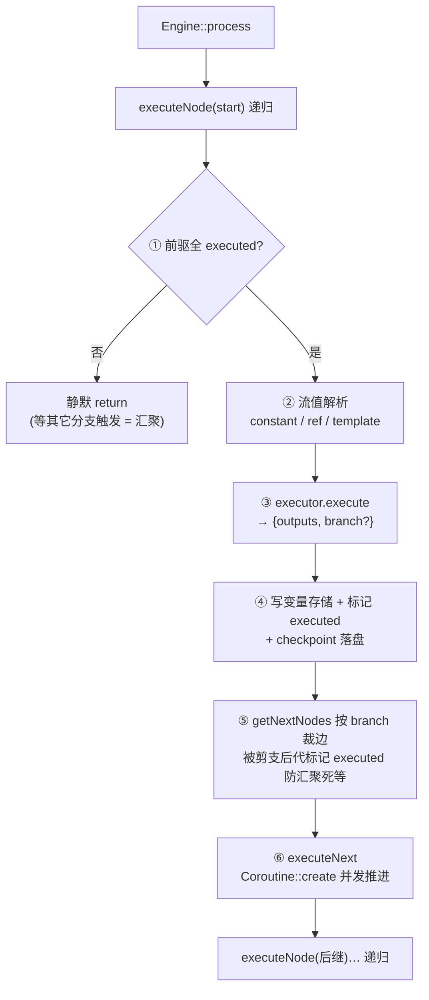
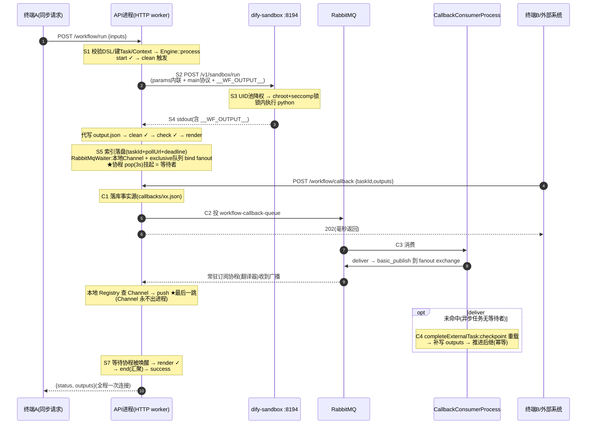
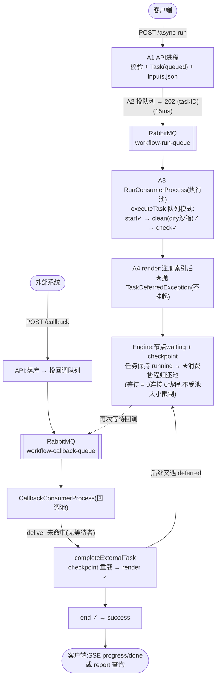
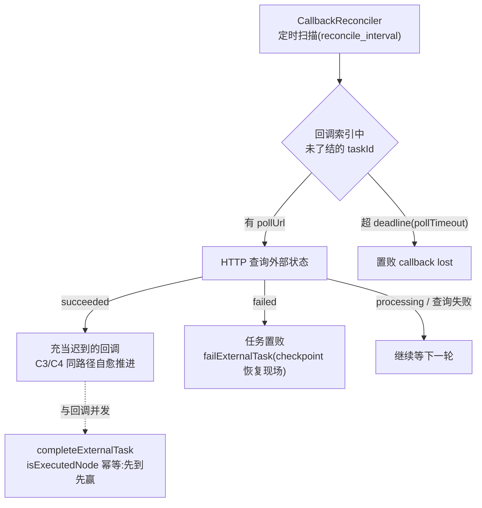

# workflow-demo

服务端工作流引擎最小可运行 demo:**Hyperf 调度器 + 可序列化 Context + 多语言代码节点沙箱(Python/JavaScript/PHP)**。

设计蓝本为字节 FlowGram 的 `@flowgram.ai/runtime-js`(调度模型)与 Coze 工作流的代码节点协议(`main` 函数约定),将浏览器端实现翻译为服务端形态。

## 架构总览

```
CLI bin/hyperf.php ─┐
                    ├─→ WorkflowApplication ─→ Engine(调度器,协程并发)
HTTP :9501 ─────────┘        │                    │
                             │                    ├─ Start/End/Condition/LLM/Video Executor(进程内)
                             │                    └─ CodeExecutor ─→ SandboxDriverFactory
                             │                                        ├ process 档(setpriv+UID池+ulimit)
                             │                                        ├ docker 档(一次性容器,五语言)
                             │                                        └ dify 档(HTTP→dify-sandbox 服务)
                             │
                             ├─ [异步模式] TaskQueue(RabbitMQ/Redis Stream 双语义队列)
                             │     ├ workflow-run-queue ──→ RunConsumerProcess(执行池)
                             │     └ workflow-callback-queue → CallbackConsumerProcess
                             │                                 (回调池 + CallbackReconciler 对账)
                             │
                             └─ TaskStore / SnapshotCenter      CallbackWaiterRegistry(五实现)
                                .runs/<taskID>/                  memory|table|redis_pubsub
                                ├── task.json       任务状态机     |redis_stream|rabbitmq
                                ├── checkpoint.json ★可序列化Context
                                └── report.json     逐节点快照(inputs/outputs/logs/耗时/branch)
```

### Engine 全链路调度流程图(同步等待 + 异步任务)

> 介质示例:taskQueue = **RabbitMQ**(run/callback 双队列)· waiter = **RabbitMQ**(fanout 广播)· 代码节点沙箱 = **difySandbox**
> 示例 DSL:`start → clean(code·python) → check(condition) → render(video·异步回调) → end`

**调度核心**(executeNode 递归,两种模式共用):

```
┌──────────────────────────────────────────────────────┐
│ Engine::process → executeNode(start) 递归            │
│ ① canExecute:前驱全 executed?否→静默 return(汇聚)   │
│ ② 流值解析:constant / ref / template                │
│ ③ executor.execute → {outputs, branch?}              │
│ ④ 写变量存储 + 标记 executed + checkpoint 落盘       │
│ ⑤ getNextNodes:按 branch 裁边;被剪支后代标记        │
│    executed(skipped)防汇聚死等                       │
│ ⑥ executeNext:Coroutine::create 并发推进后继         │
└──────────────────────────────────────────────────────┘
```



**模式一:同步等待**(HTTP run / CLI,连接保持到工作流完成):

```
【终端A】 POST /workflow/run {inputs}
   │
【API进程】S1 校验DSL → Task创建 → Context(inputs→start域) → Engine::process
   │           └ executeNode 递归:start ✓ → clean 触发
   │
【API进程】S2 clean 节点(CodeExecutor · difySandbox 档)
   │           DifySandboxDriver 协议转换:params 内联 + main() 协议包装
   │           + __WF_OUTPUT__ 标记行
   │              └──────▶【dify-sandbox :8194】S3
   │                          UID池借号 → chroot+no_new_privs+seccomp锁
   │                          → 锁内执行 python(锁前 preload 可装依赖)
   │           ◀────── S4 stdout 回收 __WF_OUTPUT__ → 代写 output.json
   │           clean ✓ → check ✓(条件求值→branch)→ render 触发
   │
【API进程】S5 render 节点(VideoExecutor · asyncCallback · 同步模式)
   │           indexCallback 落盘:taskId→node 索引 + pollUrl + deadline
   │           RabbitMqWaiterRegistry.register:
   │             本地静态表 taskId→Channel
   │             + exclusive 队列 bind fanout exchange(连接断开自动删)
   │           ★协程挂起 Channel::pop(3s短周期)← 等待者在本进程
   │             (每3s醒来查任务终态 → 感知任意推进方后从checkpoint收敛)
   │
   │           ══ 此时:1连接+1等待协程,事件驱动等待 ══
   │
【终端B·外部系统】 POST /workflow/callback {taskId, outputs}(X-Callback-Token)
   │
【API进程】C1 落库事实源(.runs/<taskID>/callbacks/<taskId>.json)
   │           C2 投 RabbitMQ workflow-callback-queue → 202 毫秒返回
   │
【CallbackConsumerProcess】(独立进程 · callback_pool_size)
   │           C3 handleCallbackMessage → deliver:
   │              basic_publish → fanout exchange(广播)
   │                 └▶【API进程】常驻订阅协程(翻译器)收到消息
   │                    → 本地 Registry 查 Channel → push ★最后一跳
   │                    (Channel 永不出进程;跨进程流动的只有 taskId+outputs)
   │           C4 deliver 未命中时(异步任务无等待者):
   │              completeExternalTask:checkpoint 重载 → 补写 outputs
   │              → 推进后继(与 executeNode 成功路径同构,幂等)
   │
【API进程】S7 等待协程被 push 唤醒 → outputs → 快照/checkpoint
   │           → getNextNodes → end(前驱全 executed→汇聚触发)→ success
   │           → runInCoroutine 完成信号 → HTTP 响应返回
   │
【终端A】 ◀══ {status, outputs}(全程一次连接)
```



**模式二:异步任务**(POST /async-run,连接毫秒释放,池化消费):

```
【客户端】 POST /workflow/async-run
   │
【API进程】A1 校验 + Task(queued) + inputs.json 落盘
   │           A2 投 RabbitMQ workflow-run-queue → 202 {taskID}(实测15ms)
   │
【RunConsumerProcess】(独立进程 · run_pool_size)
   │           A3 executeTask(AsyncContext 队列模式):读 inputs → Engine::process
   │              start ✓ → clean(dify沙箱,同 S2-S4)✓ → check ✓ → render:
   │           A4 注册索引(taskId+pollUrl+deadline)后
   │              ★抛 TaskDeferredException(不挂起!)
   │              Engine 感知:节点 waiting + checkpoint → 任务保持 running
   │              → executeTask 返回 → ★消费协程立即归还池子
   │              (等待回调任务 = 0连接+0协程,数量仅受存储容量约束)
   │
   │           ══ 回调推进(同 C1→C2→C4):deliver 未命中(无等待者)
   │              → completeExternalTask:checkpoint 重载 → render ✓
   │              → 后继若又遇 deferred → 再次暂停(多段异步天然支持)
   │              → end ✓ → 终态 success ══
   │
【客户端】 GET /workflow/events(SSE:progress/done)或 POST /report 查询
```



**兜底:CallbackReconciler**(回调丢失自愈,跑在 CallbackConsumerProcess):

```
定时扫描(config reconcile_interval)未了结的回调索引:
  ├ 有 pollUrl → HTTP 查询外部状态
  │    succeeded → 充当"迟到的回调"(走 C3/C4 同一路径)自愈推进
  │    failed    → 任务置败(failExternalTask:checkpoint 恢复现场)
  └ 超 deadline(pollTimeout)→ 置败 "callback lost"
与回调并发撞车由 completeExternalTask 的 isExecutedNode 幂等兜底(先到先赢)
```



### 调度模型(与 FlowGram 一致)

- **递归 + 协程并发**,非拓扑排序:`Coroutine::create` 替代 `Promise.all`
- **汇聚**:后继节点要求所有前驱已执行(`canExecuteNode`),不满足静默跳过等其它分支触发
- **分支裁剪**:条件节点只返回 `branch`,引擎按 `fromPort` 裁边;被剪分支的独占后代直接标记 `executed/skipped`,防汇聚点死等
- **变量系统**:`Map<nodeID, Map<key, Variable>>`,三种流值 `constant` / `ref([nodeID,key,...path])` / `template("{{nodeID.key}}")`

### ★ 可序列化 Context

每节点成功后 `WorkflowContext::serialize()` 落盘 `checkpoint.json`(变量存储 + 已执行集合 + 节点状态)。
`workflow resume <taskID>` 反序列化恢复,从"前驱已满足但未执行"的节点继续,**不重跑已完成节点**。

### ★ 多语言代码节点(统一 Runner 协议)

用户代码约定(与 Coze/FlowGram/Dify 一致),数据以 JSON 文件过引擎↔沙箱边界(`input.json` → `output.json`),沙箱内拿不到引擎任何全局状态:

```python
# Python:          def main(params) -> dict
# JavaScript:      async function main({ params }) { return {...}; }
# PHP:             function main(array $params): array
```

#### 三档沙箱(docker / process / dify)—— 完整沙箱体系

同一引擎、同一 Runner 协议,只有"执行方式"不同,构成控制变量的对比实验:

| | `process` 档(进程级) | `dify` 档(远程沙箱服务) | `docker` 档(一次性容器) |
|---|---|---|---|
| 隔离单元 | 进程(setpriv 降权 + UID 池 + ulimit) | dify-sandbox 服务(chroot+seccomp+UID 池) | 容器(namespace/cgroup/seccomp) |
| 调用方式 | 本容器 `Coroutine::exec` 子进程 | HTTP `POST /v1/sandbox/run`(host-gateway) | Docker Engine API(curl + unix socket) |
| 网络 | ❌ 无法禁网 | 服务侧 seccomp 开关 + 代理 | ✅ `NetworkMode: none` 硬禁 |
| 文件系统 | 一次性私有工作目录 | dify 服务内部临时目录 | 只读 rootfs + tmpfs + 挂载 /task |
| 语言 | py/js/php | py/js(dify 上游仅此) | **五语言** py/js/php/golang/java |
| 冷启动(实测) | ~35-70ms | **~23-30ms** ⚡ | ~130-250ms |
| 部署形态 | 引擎同进程 | 独立 Go 服务(生产 sandbox-manager 形态) | 引擎经 daemon 拉起 |
| 适用 | 内部可信/高频 | 服务化解耦/独立扩缩容 | 开放多租户 |

#### 语言支持矩阵(五语言)

| 语言 | process 档 | docker 档 | dify 档 |
|---|:---:|:---:|:---:|
| Python(`def main(params) -> dict`) | ✅ | ✅ | ✅(API 语言名 `python3`) |
| JavaScript(`async function main({params})`) | ✅ | ✅ | ✅(API 语言名 `nodejs`,CJS 语义,无顶层 await) |
| PHP(`function main(array $params): array`) | ✅ | ✅ | ❌ 上游无此 runner |
| Golang(`func Main(params) (map[string]any, error)`) | ❌ | ✅ **编译型** | ❌ |
| Java(`class User { static Map main(Map) }`) | ❌ | ✅ **编译型** | ❌ |

**编译型语言(Go/Java)只走 docker 档**——工具链体积不适合进程级镜像、dify 上游无 runner。两个实测方案(均为全隔离参数下跑通):

| | Golang | Java |
|---|---|---|
| 执行方式 | `go run wire.go code.go` **双文件壳**(同 package 链接,import 互不冲突) | **引擎侧预拼接**(壳模板 Main.java + 用户 User 类)后 JEP 330 单文件源码模式 |
| 用户代码形态 | 完整合法 Go 文件(自带 package/import,定义导出 `Main`) | 顶层 `class User` 声明,**无 import**(壳预置 java.util/gson) |
| 跨执行缓存 | ✅ GOCACHE 挂宿主 `.gocache/`:冷编译 ~12.8s → 热 **~0.2-0.3s** | JEP 330 每次内存编译 ~1.8s(生产可换 javac 产物缓存/AppCDS) |
| 超时 | 60s(`compiled_timeout`,含编译) | 60s |
| 特殊参数 | tmpfs 需 `exec`(编译产物在 /tmp 执行)、GOMAXPROCS=2(防撞 pids-limit) | 内存抬到 512m、SerialGC |

**dify 档语言限制的来源**:`dify-sandbox` 的 `internal/controller/run.go` 只分发 `python3` / `nodejs` 两个 case(其余 400 unsupported),配套也只有 `runner/{python,nodejs}/` 两套 runner、`python_path`/`nodejs_path` 两个解释器配置、`static/{python_syscall,nodejs_syscall}` 两份 syscall 白名单——上游产品侧代码节点本就只暴露双语言。DifySandboxDriver 对 php 节点显式抛错并引导换档,而非静默失败。

**实践建议**:工作流含 php 节点时用节点级档位覆盖——python/js 节点选 `dify`(最快),php 节点指定 `data.sandboxDriver: "docker"` 或 `"process"`(`examples/mixed-sandboxes.json` 即此布局)。

**扩展指引**(暂不实现):若要 dify 档支持 php,需在上游仿照 nodejs 增加完整一套——`internal/core/runner/php/` runner + `static/php_syscall/` 白名单 + `cmd/lib/php/` 的 c-shared seccomp 锁库(php 版 prescript),工作量约等于移植半个 nodejs 分支;当前阶段用三档混合调度绕过即可。

**切换方式**:全局 `config/autoload/workflow.php → 'sandbox_driver'`;节点级 `data.sandboxDriver`(见 `examples/mixed-sandboxes.json`:python=dify / js=docker / php=process,一图三档对比)。

**dify 档协议转换**(`DifySandboxDriver.php`,核心教学点):引擎文件协议(code.* + input.json → output.json)与 dify HTTP 协议({language, code} → {stdout, stderr})的适配——params 内联进包装代码(JSON_HEX 转义)、追加 main() 调用与 `__WF_OUTPUT__` 结果标记行、driver 代写 output.json 保持上层零改动。nodejs 侧按 CJS 语义用 Promise 链(dify 以 test.js 普通脚本执行,无顶层 await)。

**dify-sandbox 宿主部署踩坑实录**(服务以 `sudo ./main` 运行于 `:8194`,详见 `/home/zw/goweb/dify-sandbox`):

1. `useradd sandbox(65537)` 需要 root → `sudo useradd -u 65537 sandbox`
2. `/var/sandbox/{sandbox-python,sandbox-nodejs}` 初始化需要权限 → `sudo mkdir + chown`
3. **`fs.protected_hardlinks`**:普通用户对 root 属主的系统 .so 无写权限,env.sh 的 `ln -f` EPERM → fallback `cp` 又撞上重复路径(lib-dynload 被 stdlib 和独立路径发现两次)第一轮留下的 444 文件 → 权限不够 panic。根因:官方语义就是容器内 root 运行(chroot/setuid 需要 CAP_SYS_CHROOT),**以 root 跑即全部解决**
4. busybox 自带阉割版 `setpriv` 不支持 `--reuid`:引擎容器安装检测标志必须用 `python3` 而非 `setpriv`(compose command 已注释)

**process 档与 dify-sandbox 源码对照**(完整注释见 `ProcessSandboxDriver.php` 头部):

| dify 原版(Go) | 本 demo(PHP) |
|---|---|
| `uidpool/uid_pool.go`(chan 池) | `UidPool`(Swoole Channel ≡ Go chan,一字同构) |
| `add_seccomp.go`:chroot→no_new_privs→seccomp→setuid 序列 | `setpriv --reuid/--regid/--clear-groups --no-new-privs`(seccomp/chroot 差距保留并注明原因) |
| InitializeEnvironment + AfterExitHook(一次性临时目录) | `.proc_<uid>_<rand>/` 私有工作目录 + finally 清理 |
| conf `allowed_env_vars` | `workflow.sandbox.allowed_env_vars`(两档共用) |
| 无内存硬限制(已知弱项) | ulimit 补齐(反向借鉴) |

**docker 档**四层隔离:`--memory 256m --cpus 0.5 --pids-limit 64`(cgroup)/ `NetworkMode: none` / 只读 rootfs + tmpfs / `cap-drop ALL` + `no-new-privileges` + 非 root + seccomp 白名单(`docker/seccomp-profile.json`)。

沙箱日志协议:stderr 按 JSON Lines(`{"level":"log","msg":"..."}`),收集进节点快照。
退出码语义:`0` 成功 / `124` 超时 / `137` OOM / 其他 = 运行时错误。代码节点默认不重试。

#### 教学级踩坑实录(代码注释里都有)

1. **UID 池必须配一次性目录**:同目录被不同 UID 先后使用,Python `__pycache__` 属主是上一个 UID → `PermissionError`;dify 的一次性临时目录正是为此
2. **`mkdir(0777)` 被 umask 削成 0755**:必须显式 `chmod`,否则降权 UID 写不了 output.json
3. **Swoole worker 改名导致 pkill 失效**:旧 server 僵尸持端口,新 server "Address in use" 静默失败,测试全打到旧代码——排查性能问题第一步永远是确认"测的是新代码"
4. **Symfony Process 的 1ms 轮询在 hyperf EventLoop 里被放大到 ~200ms**:process 档改用 `Coroutine::exec`(协程挂起等待,不轮询)
5. **busybox sh 在 seccomp 下的未解之谜**:ENTRYPOINT 经 `sh -c "cat a b > /tmp/x"` 在白名单 profile 下 255 秒退,而 LOG 放行/strace 观测的 syscall 全集均 ⊆ 白名单 → 规避:**编译型语言在引擎侧预拼接**(dify 官方同款:api 侧拼好整段代码),沙箱内不再出现 sh/cat
6. **seccomp 白名单的编译型补课**(每条都是真实报错):`execve`(容器入口)、`clone/clone3`(V8/pthread)、`fork/vfork`(musl 的 fork 走 SYS_fork)、`wait4/waitid`(go 工具链收割子进程)、`mkdir 族`(go 建 work dir)、`flock`(go 缓存锁)、`sendfile/copy_file_range`(coreutils fast path)、`capget/capset + setgroups/setuid 族`(runc init,与 dify 白名单同款)、`getpgrp/getsid 族`(shell job control)
7. **tmpfs 默认 noexec**:go 把编译产物放 /tmp 并直接执行 → EACCES,tmpfs 须加 `exec` 选项
8. **显式 Env 覆盖镜像 ENV PATH**:golang 在 /usr/local/go/bin,透传 PATH 白名单变量反而让 `go` 找不到——docker 档的 env 白名单必须跳过 PATH
9. **go run 要求所有源文件同目录**:wire.go 必须与 code.go 一起落在 /task(引擎侧下发),跨目录双文件直接报错
10. **GOCACHE 属主是容器内 nobody**:宿主清理需 sudo;生产应规划缓存目录 UID 或专用卷
11. **Docker wait 的 next-exit 竞态**:秒级任务在 HTTP 常驻进程下偶发 30s 超时——容器已退出后调 `next-exit` 会永等"下一次退出";改用 `not-running`(电平语义,已退出立即返回)
12. **Swoole BASE 模式无 worker 间管道**:`sendMessage` 仅 `SWOOLE_PROCESS` 模式支持(BASE 下返回 false,跨 worker 投递静默退化为慢路径)——Table 注册表必须配 PROCESS 模式
13. **worker 内拿不到 Swoole Server**:worker 容器是 fork 后重建的,`ServerFactory::getServer()` 抛错;唯一可靠来源是 `BeforeWorkerStart` 事件(经 `config/autoload/listeners.php` 配置式注册注入;**@Listener 注解在本环境未生效**)
14. **容器 PID1 不收割僵尸 + 重启正确姿势**:容器 PID1 是 `tail`,`kill -9` master 后 worker 孤儿变 Z 僵尸(占端口表项、干扰排障);**重启 server 一律 `docker restart wf-engine`**,不要在容器内 pkill/kill master
15. **Swoole BASE 模式 reuseport 同源聚集**:同源 IP 连接倾向同一 worker,跨 worker 测试需并发或 PROCESS 轮询模式

## 快速开始

```bash
# 1. 起引擎容器(复用 php84-swoole-hyperf 镜像,挂 docker.sock)并装依赖
docker compose up -d wf-engine
docker exec wf-engine sh -c "cd /var/project/workflow-demo && composer install"
# 消息介质(按 callback_registry 选配):docker compose up -d redis rabbitmq

# 2. 构建全部语言沙箱镜像(五语言;编译型 golang/java 亦在此列)
docker compose build wf-sandbox-python wf-sandbox-node wf-sandbox-php wf-sandbox-golang wf-sandbox-java

# 3. CLI 跑示例流(长文本 → JS 打分分支)
docker exec wf-engine sh -c "cd /var/project/workflow-demo && \
  php bin/hyperf.php workflow run examples/first-flow.json --inputs='{\"query\":\"  hello workflow engine demo  \"}'"

# 五语言流水线:python → js → golang → php → java 串行加工(编译型走 docker 档)
docker exec wf-engine sh -c "cd /var/project/workflow-demo && \
  php bin/hyperf.php workflow run examples/all-languages.json --inputs='{\"query\":\"  hello polyglot workflow  \"}'"

# LLM 节点(mock 模式零依赖;配置 workflow.llm 后走真实 OpenAI 兼容 API)
docker exec wf-engine sh -c "cd /var/project/workflow-demo && \
  php bin/hyperf.php workflow run examples/llm-flow.json --inputs='{\"topic\":\"多语言沙箱\"}'"

# 长耗时异步节点:video mock 8s 协程挂起,期间引擎可并发跑其它工作流(见下节)
docker exec wf-engine sh -c "cd /var/project/workflow-demo && \
  php bin/hyperf.php workflow run examples/async-video-flow.json --inputs='{\"topic\":\"协程引擎\"}'"

# 短文本 → PHP 兜底分支(JS 节点被裁剪为 skipped)
docker exec wf-engine sh -c "cd /var/project/workflow-demo && \
  php bin/hyperf.php workflow run examples/first-flow.json --inputs='{\"query\":\"  hi 小主  \"}'"

# 双档沙箱对比(教学):同一工作流内 process/docker 混跑,快照 timeCost 直接对比冷启动
docker exec wf-engine sh -c "cd /var/project/workflow-demo && \
  php bin/hyperf.php workflow run examples/mixed-sandboxes.json --inputs='{\"query\":\"compare sandbox drivers\"}'"
# ↑ 2026-10 起为三档混合:python=dify 远程服务档 / js=docker 档 / php=process 档
# 前置:dify-sandbox 服务需在宿主机以 root 运行(sudo ./main,端口 8194)

# 4. HTTP API(启动 Server 后,宿主 49601 端口)
docker exec -d wf-engine sh -c "cd /var/project/workflow-demo && php bin/hyperf.php start"
curl -s -X POST :49601/workflow/run -d '{"workflow":"first-flow","inputs":{"query":"hi"}}'
curl -s -X POST :49601/workflow/report -d '{"taskID":"task_xxxx"}'
curl -s -X POST :49601/workflow/validate -d '{"workflow":"first-flow"}'
curl -s -X POST :49601/workflow/resume -d '{"taskID":"task_xxxx"}'
```

## 断点恢复演示(fail-then-resume)

```bash
# 第一次运行:bad 节点 raise → 任务 failed,但 checkpoint 已保留 start 的执行状态
php bin/hyperf.php workflow run examples/fail-then-resume.json --inputs='{"value":21}'

# 修复 DSL(把 bad 节点的 raise 换成 return)后从断点恢复:
php bin/hyperf.php workflow resume <taskID>
# ✓ start 不重跑,从 bad 继续执行 → success,outputs: {"doubled": 42}
```

## 运行产物

```
.runs/task_<id>/
├── task.json                 # 任务状态机(created/running/success/failed + error)
├── checkpoint.json           # ★ 可序列化 Context(变量存储 + executedNodes + 节点状态)
├── report.json               # 逐节点快照:inputs/outputs/branch/logs/error/耗时
└── nodes/<nodeID>/
    ├── code.py|js|php        # 注入沙箱的用户代码
    ├── input.json            # {"params": {...}}
    └── output.json           # {"ret": {...}}(沙箱写出)
```

## 目录结构

```
app/Workflow/
├── Application/WorkflowApplication.php   # 应用服务(CLI/HTTP 共用)
├── Context/WorkflowContext.php           # ★ serialize()/restore() 可序列化上下文
├── Document/{Document,NodeModel}.php     # DSL → 图模型(prev/next 索引 + 环/起止校验)
├── Engine/Engine.php                     # 调度器:汇聚/裁剪/协程并发/checkpoint
├── Engine/Executors/{Start,End,Condition,Code}Executor.php
├── Engine/Executors/LLMExecutor.php              # OpenAI 兼容 Chat(mock 可零依赖教学)
├── Engine/Executors/VideoExecutor.php            # 长耗时异步范型:协程挂起,引擎零改动
├── Sandbox/SandboxDriverInterface.php       # ★ 三档沙箱统一协议(文件协议固化)
├── Sandbox/SandboxDriverFactory.php         # 档位选择:全局配置 + 节点级覆盖
├── Sandbox/DockerSandboxDriver.php          # 档2:一次性容器(Engine API 直调)
├── Sandbox/ProcessSandboxDriver.php         # 档1:进程级(dify 同构,教学注释集大成)
├── Sandbox/DifySandboxDriver.php            # 档3:远程沙箱服务(HTTP 协议转换核心)
├── Sandbox/UidPool.php                      # UID 池(Swoole Channel ≡ dify Go chan 池)
├── Snapshot/SnapshotCenter.php           # 逐节点快照 → report.json
├── State/WorkflowState.php               # constant/ref/template 解析 + executedNodes
├── Task/TaskStore.php                    # 任务状态机(JSON 文件存储)
└── Variable/VariableStore.php            # Map<nodeID, Map<key, Variable>>
docker/
├── runners/                                 # 五语言统一 Runner(文件协议)
│   ├── {runner.py,runner.mjs,runner.php}    # 解释型:镜像内置,加载用户代码调 main()
│   ├── wire.go                              # 编译型(Go):双文件壳,与用户 code.go 同 package 编译
│   └── Main.java                            # 编译型(Java):壳模板,引擎预拼接后 JEP330 执行
├── sandbox-{python,node,php}/Dockerfile        # 轻量沙箱镜像(ENTRYPOINT 内置 runner)
└── seccomp-profile.json                         # syscall 白名单
```

## 异步长耗时节点(LLM 生视频等)的执行模型

**第一层(协程挂起)**:引擎零改动,executor 内协程化等待让出协程、不占 worker——实测 video 挂起 8002ms 期间,普通工作流 548ms 照常完成(同 worker 并发)。

**第二层(回调闭环,已落地)**:`examples/async-callback-flow.json` + `POST /workflow/callback`,双路径架构:

```
外部完成回调 → ① 落库(事实源,无论等待者死活)
             → ② 快路径:CallbackWaiterRegistry 命中(同进程)→ Channel push,挂起协程毫秒级续跑
             → ③ 慢路径:未命中(跨进程/进程重启)→ checkpoint 重载 + completeExternalTask 推进
```

三剧本实测(`X-Callback-Token: demo-token`,taskId 在 `.runs/<taskID>/nodes/render/waiting-callback.json`):

```bash
# 剧本1 快路径:终端A run 挂起(HTTP)→ 终端B 回调 → delivered=channel,run 响应直接返回结果
curl -s -X POST :49601/workflow/run -d '{"workflow":"async-callback-flow","inputs":{"topic":"x"}}' &
curl -X POST :49601/workflow/callback -H 'X-Callback-Token: demo-token' \
  -d '{"taskId":"<waiting-callback.json 里的 taskId>","outputs":{"videoUrl":"https://ext/v.mp4"}}'

# 剧本2 跨进程:CLI run 挂起 + HTTP 回调 → delivered=reloaded(Channel 跨进程不通的活教材,
#          慢路径重载推进,report 显示 success,CLI 侧超时报错以 report 为准)

# 剧本3 重启 killer:run 挂起 → kill server(等待者死)→ 重启 → 回调 →照样 reloaded 推进至 success

# 幂等:已投递的 taskId 再回调 → "not found or already delivered"(索引即一次性投递凭据)
```

**组件**:`Engine/Waiter/` 四实现注册表(见下表)| `TaskStore` 回调索引与事实(JSON 文件,生产替换点 Redis/DB)| `Engine::completeExternalTask`(慢路径重载推进)| `resume` 自动跳过等待回调节点(防外部任务重复提交)| 入口统一走黄金法则:落库 → 投递(deliver)→ 跨进程投出后 3s 延迟复查兜底(等待者死/投递丢 → completeExternalTask,幂等双推进安全)。

**等待者注册表五实现**(config `workflow.callback_registry` 切换,跨进程流动的只有 taskId+outputs,Channel 永不出进程):

| 实现 | 配置值 | 跨进程介质 | 翻译器 | 实测 |
|---|---|---|---|---|
| InMemory | `memory`(单 worker 专用) | 无 | deliver 直推 | in_process ✓ |
| Table | `table`(**默认**,worker_num=2) | Swoole\Table 路由凭证 + `sendMessage` 定向管道 | `onPipeMessage` | 6/6 `pipe_message`(等待者 w1 ← 回调 w0)✓ |
| RedisPubSub | `redis_pubsub` | Redis PUBLISH 广播 | 常驻订阅协程(惰性启动) | **跨进程**:CLI 挂起 + HTTP 回调 → CLI 进程内续跑 ✓ |
| RedisStream | `redis_stream`(MQ 形态) | Redis Stream + 每进程独立消费组(持久化/XACK) | 常驻消费协程 | 跨进程 + 事件持久化(XLEN=1, pending=0)✓ |
| RabbitMQ | `rabbitmq`(MQ 形态) | fanout exchange + 每进程 exclusive 队列(basic_ack 手动确认;php-amqplib 直连) | 常驻消费协程 | 跨进程:CLI 挂起 + HTTP 回调 → `amqp` → CLI 进程内续跑 ✓ |

Table 模式依赖(已固化):`SWOOLE_PROCESS` 模式(**BASE 模式无 worker 间管道,sendMessage 不可用**)| `TableWaiterRegistry::boot()` 于 master 阶段(config/server.php 顶部,fork 前创建才共享)| `WorkerServerHolderListener` 注入 server 引用(config/listeners.php 配置式注册——**注解 @Listener 在本环境不生效**)。

**生产 durable 清单**(未实现部分见教学手册 03§7):多 worker/多实例路由、等待超时自动失败、run 异步任务式。

## 生产形态:任务队列异步消费(async-run)

**为什么**:阻塞式 run 的资源账本——一个进行中任务 = 1 连接 + 1 请求协程长期挂死;批量长任务 → `max_connection`(ulimit fd)先爆,吞吐与连接数绑死。

```
POST /workflow/async-run ──校验→ Task(queued)+inputs 持久化→ 入队 → 202 {taskID}(实测 15ms,连接零占用)
POST /workflow/callback  ──落库→ 投"继续消息" → 202(毫秒返回)
        ┌── 任务队列(竞争消费:XACK/断线补读)──┐
   WorkflowConsumerProcess(hyperf/process 独立进程)  │
   │ 消费协程池(池大小=并发上限=削峰)                  │
   │  run 消息      → executeTask(引擎零改动)         │
   │  callback 消息 → Registry deliver(同步等待者)     │
   │                  未命中 → completeExternalTask    │
   │                  (单点决策,消灭双推进竞态)        │
   状态:report 轮询 / GET /workflow/events(SSE progress/done 事件)
```

**双队列双进程(run / callback 拆分)**:任务执行(重且长)与回调推进(轻且快)物理隔离——`RunConsumerProcess`(run 队列,`run_pool_size`)与 `CallbackConsumerProcess`(callback 队列 + 对账器,`callback_pool_size`)。**拆分收益实测**:run 池被 4 个长任务(all-languages ~2.5s)占满期间,回调推进仅 **0.52s** 完成(混池时会排队等池空闲);独立扩缩容(run 按负载扩、callback 恒定小池)、故障隔离(沙箱执行异常不波及回调)。物理拆分是必须的:Redis Stream 同组竞争会把 run 消息分给回调进程,语义队列必须独立。

**双队列实现**(config `workflow.task_queue`,与五 Registry 的广播语义对照——**任务队列=竞争消费,唤醒=广播**):`redis_stream`(默认,单组多 consumer)/ `rabbitmq`(work queue:durable + persistent + ACK,跨重启不丢)。

**验证**:批量 20 并发提交 19ms 全收 → 池化消化;异步回调闭环(async-run→waiting→callback 入队→消费进程推进→success);SSE progress/done 正常;RabbitMQ 队列消费干净(messages=0);**同步模式零破坏**(等待者升级为"短周期 pop + 任务终态感知":被消费进程推进后 ≤3s 从 checkpoint 收敛,executeNode 链路幂等)。

**池释放语义(等待任务数 ≠ poolSize)**:队列模式下 deferred 节点"注册即暂停"——executor 抛 `TaskDeferredException`(仅 `AsyncContext` 队列模式),Engine 感知:节点 waiting + checkpoint 落盘 + 任务保持 running → **消费协程立即归还池子**。两类并发的上限因此分离:

| | 上限 | 机制 |
|---|---|---|
| 执行中(CPU/IO 活跃)工作流 | poolSize(削峰,特性) | 消费协程池 |
| **等待回调中的任务** | **存储容量**(万级;0 连接 + 0 协程) | 纯存储态,回调消息驱动重载推进 |

实测:poolSize=4 下提交 6 个回调等待流(全部 running 暂停)→ **第 7 个普通任务 2 秒完成**(池空闲证明)→ 逐个回调推进 6/6 success。推进链遇下一个 deferred 节点会再次暂停(`advanceExternalTask` 同在队列模式);同步模式(HTTP/CLI run)不受影响,仍走协程挂起 + 终态感知收敛。

**回调对账兜底(Reconciliation)**:回调是"外部主动告知",天然不可靠——`CallbackReconciler`(消费进程内定时协程,config `reconcile_interval` 默认 30s)扫描所有未了结的回调索引:有 `pollUrl`(注册时随索引持久化的外部状态查询句柄)则主动 HTTP 查询,`succeeded` 充当"迟到的回调"推进(与回调路径同一收敛点,幂等)、`failed` 置败;超过 `deadline`(`pollTimeout`,默认 600s)则置败"callback lost"。**示例 `examples/reconcile-flow.json`**(pollUrl 指向 `/workflow/mock-status` 模拟外部系统,pollTimeout=45s):剧本A 回调丢失自愈(写 mock 文件→对账器 10s 内查询自愈推进,实测 success);剧本B 超时置败(45s failed "external callback lost");回调优先回归(正常回调即时,对账器不干扰)。教学:`.runs/<taskID>/mock-external/<taskId>.json` 即模拟外部状态的写入口。

## 已知简化(demo → 生产的差距)

| 项 | demo 做法 | 生产建议 |
|---|---|---|
| SSE 推送 | 端点内 500ms 轮询 report 差量 | 引擎状态变化 publish Redis Pub/Sub,SSE 端点订阅转发(零轮询) |
| 队列重投 | 失败不 ACK 留 pending | XAUTOCLAIM(Redis)/ 死信队列 + 重试上限(RabbitMQ) |
| 沙箱调度 | 引擎容器挂 docker.sock 直调 Engine API | 独立 sandbox-manager 服务(gRPC),按租户配额 + 预热池 |
| 挂载路径 | `workflow.path_map` 手工映射容器↔宿主路径 | 沙箱专用共享存储(NFS/对象存储)或同宿主部署 |
| 文件权限 | 任务目录 chmod 0777(nobody 可写) | 专用 UID 规划 + uidmap |
| 任务存储 | JSON 文件 | DB/Redis,Task 表 + 快照表,支持查询/清理 |
| 取消/超时 | 节点级 wall-clock 超时 | 工作流级取消标志 + 沙箱批量回收 |
| Loop/子流程 | 未实现(runtime-js 有完整参照:sub() 子上下文 + cache 标志) | scopePath 可序列化作用域链 |
| 分层 | 引擎为领域组件,未套 Controller→Service→Repository | Controller 保持薄,领域层独立成包 |

## 编码约定

遵循团队护栏:协程内状态走 Context/局部变量、`BusinessException + ErrorCode`、统一响应 `{status_code, msg, data, extra}`、POST 路由带用途注释、日志走 LoggerFactory。
